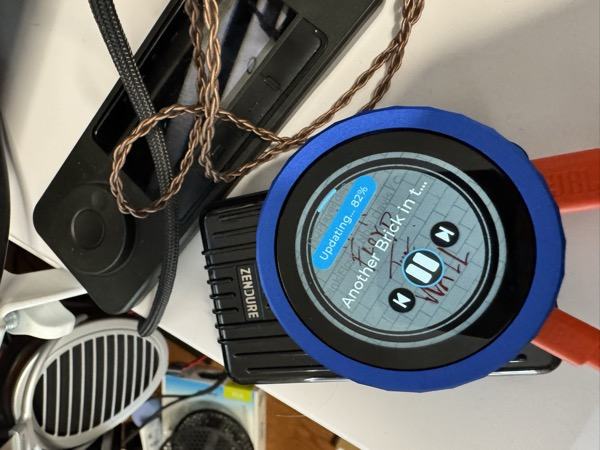

# HiPhi Dial firmware (Waveshare knob fork)

[](https://github.com/maar0005/Hi-fi-Waveshare-knob-forked-/actions/workflows/docker.yml)
[](https://github.com/maar0005/Hi-fi-Waveshare-knob-forked-/releases/latest)

**HiPhi by Open Horizon Labs** — [hiphi.audio](https://hiphi.audio/) · Fork of [muness/roon-knob](https://github.com/muness/roon-knob)

Dedicated hi-fi controllers built from commodity ESP32 hardware. A HiPhi controller sits on your desk, your couch, or your wall and does one thing well: show what is playing and let you change it — transport, volume, zones — without opening a phone or a laptop. This fork holds the firmware for one controller, the HiPhi Dial on the Waveshare ESP32-S3 knob, and adds Home Assistant light dimming. The other HiPhi controllers live in the upstream repository. The Dial talks to the bridge, [Unified Hi-Fi Control](https://github.com/open-horizon-labs/unified-hifi-control), which connects to Roon, Lyrion Music Server (LMS), and OpenHome/UPnP renderers.

[](https://photos.app.goo.gl/s5LpWqBTaXRihmjh7)
*Click to watch a video demo of the HiPhi Dial*

> **Firmware maturity:** these builds are **Alpha**. The Home Assistant lights
> feature has not yet been tested on physical hardware.

## Hardware

| Controller | Hardware | Firmware |
|---|---|---|
| **HiPhi Dial** | [Waveshare ESP32-S3-Knob-Touch-LCD-1.8](https://www.waveshare.com/esp32-s3-knob-touch-lcd-1.8.htm) | [Releases](https://github.com/maar0005/Hi-fi-Waveshare-knob-forked-/releases) |
| Dial auxiliary parking image | Waveshare knob, second ESP32 | [Releases](https://github.com/maar0005/Hi-fi-Waveshare-knob-forked-/releases) |

Flash with `esptool.py`; see [firmware flashing](docs/usage/FIRMWARE_FLASHING.md). To keep Wi-Fi and settings, write only `hiphi_dial.bin` at `0x10000`. Automatic updates come from the bridge and install upstream firmware without this fork's changes.

## What You Need

1. **Hardware**: the Waveshare ESP32-S3-Knob-Touch-LCD-1.8 (~$50).
2. **Music source**: Roon Core, Lyrion Music Server, or an OpenHome renderer on your network.
3. **Docker host** (NAS, Raspberry Pi, always-on computer) to run the bridge.

> **New to this?** See the [Getting Started from Scratch](docs/usage/GETTING_STARTED.md) guide.

## Run the Bridge

The Dial talks to the bridge, Unified Hi-Fi Control. Set it up once and every controller on your network can use it.

**Docker (recommended)**

On any Docker host (NAS, Raspberry Pi, etc.):

```yaml
# docker-compose.yml
services:
  unified-hifi-control:
    image: muness/unified-hifi-control:latest
    restart: unless-stopped
    network_mode: host
    volumes:
      - unified-hifi-control-data:/data

volumes:
  unified-hifi-control-data:
```

```bash
docker compose up -d
```

> **Note:** The legacy image name `muness/roon-extension-knob` still works and receives the same updates.

**Already have the [Roon Extension Manager](https://github.com/TheAppgineer/roon-extension-manager)?**

Find "Unified Hi-Fi Control" in the extension list and install it from there (Roon-only mode).

**Roon users:** go to **Roon → Settings → Extensions** and enable **"Unified Hi-Fi Control"**.

Controllers find the bridge automatically over mDNS. Each controller remembers the selected bridge's name and resolves its current address when reconnecting, so an IP change does not normally require editing settings. See [connection recovery](docs/connection-recovery.md) for the status vocabulary and recovery behavior.

## Guides

- **HiPhi Dial** — [quick start, controls, and troubleshooting](docs/usage/DIAL.md)
- **Home Assistant lights** — [setup and use](docs/usage/HOME_ASSISTANT_LIGHTS.md)
- **Target notes** — [Dial and auxiliary image](docs/targets/README.md)
- **Setup** — [firmware flashing](docs/usage/FIRMWARE_FLASHING.md), [Wi-Fi provisioning](docs/usage/WIFI_PROVISIONING.md), [OTA updates](docs/usage/OTA_UPDATES.md)

## Features

- Real-time now playing with album artwork
- Velocity-sensitive volume control
- Library browsing, including Roon playlists (Menu → Library → Playlists)
- Home Assistant light dimming from the knob (Menu → Lights)
- Multi-zone support across Roon, LMS, and OpenHome
- Automatic display dimming and sleep
- Bridge-served firmware update checks and user-started OTA installation (installs upstream firmware)
- Wi-Fi setup via captive portal

## Development

See [DEVELOPMENT.md](docs/dev/DEVELOPMENT.md) for building firmware, running the PC simulator, and contributing. Agent-facing context lives in [AGENTS.md](AGENTS.md).

## Roadmap

See [PROJECT_AIMS.md](docs/meta/PROJECT_AIMS.md) for project goals and decision framework, and [ROADMAP_IDEAS.md](docs/meta/ROADMAP_IDEAS.md) for user feedback and planned improvements.

## Support

Questions or issues? [Open an issue](https://github.com/muness/roon-knob/issues), join the [Roon Community discussion](https://community.roonlabs.com/t/50-diy-roon-desk-controller/311363), visit [hiphi.audio](https://hiphi.audio/), or [buy me a coffee](https://www.buymeacoffee.com/muness).

## License

The firmware is **free for individuals to use on their own systems**, and it is **noncommercial only**. It is released under the [PolyForm Noncommercial License 1.0.0](LICENSE).

You can build it, flash it, modify it, and run it on your own gear at home for free.

If you are an **installer, integrator, or dealer**, or you are **deploying it for clients**, **bundling it with hardware you sell**, or making it part of a **paid, hosted, or managed service**, you need a commercial license. See [COMMERCIAL-LICENSE.md](COMMERCIAL-LICENSE.md).

Versions up to and including v2.2.2 were released under the [MIT License](LICENSE-MIT).

## Acknowledgments

Thanks to **gTunes** from the Roon community for alpha testing, detailed feedback, and help with the velocity-sensitive volume control implementation.
